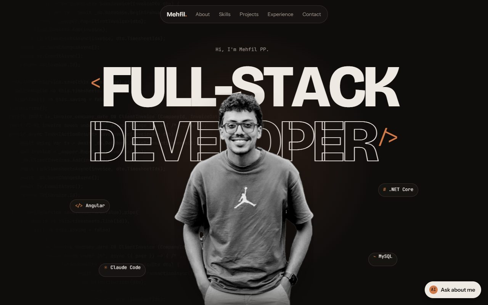

# Mehfil PP · Portfolio

Personal portfolio of **Mehfil PP**, Full-Stack Developer (Angular & .NET) working on a production multi-tenant ERP, with AI-assisted engineering.

**Live site:** https://mehfil84.github.io



## What's on the page

- **Hero:** a large headline with a cut-out portrait in front of it. The letters rise in on load, badges float around the portrait, and a spotlight follows the mouse.
- **Highlights:** 1,500+ commits, 80+ Playwright tests, a backfill migration cut from 5 min 04 s to 15 s, and 88% accuracy on the Resume Analyzer model. The numbers count up on load.
- **About, Toolkit, Experience:** background, skills grouped by area, and work history.
- **Featured projects:** folder-style cards that open into case studies:
  - [Resume Analyzer](https://github.com/mehfil84/Resume-Tracker), ML resume scoring
  - Bug-Fix Agent Loop, Claude Code agents from GitLab issue to verified fix
  - Ledger Migration Tool, legacy accounting data into a new Finance module
  - The 504 Fix, SQL performance work
- **Footer:** a contribution-style grid whose brightest cells spell the name, with the portrait standing beside it.
- **Ask about me:** a chat panel that answers common questions from the resume. It uses keyword matching in the browser, with no AI service and no network calls.

## Tech

Plain HTML, CSS and JavaScript in a single `index.html`. There is no framework and no build step.

- Fonts: Bricolage Grotesque, Instrument Sans and JetBrains Mono from Google Fonts
- Animation: CSS keyframes and scroll-driven animations, plus a small amount of JavaScript for the typewriter text, counters and parallax
- Respects `prefers-reduced-motion`
- Responsive down to phone width

## Run locally

Open `index.html` in a browser, or serve the folder:

```bash
npx serve .
# or
python -m http.server 8000
```

## Structure

```
index.html          the whole site (markup, styles, scripts)
assets/
  mehfil.jpg        portrait photo
  cutout.webp       portrait with the background removed
  favicon.svg       tab icon
  og.jpg            social preview image
  screenshot.jpg    image used in this README
404.html            page for unknown URLs
.nojekyll           serve files as-is on GitHub Pages
```

## Deploy

The site is served by GitHub Pages from the `main` branch root of the `mehfil84.github.io` repository. Every push to `main` updates the live site.

## Contact

- Email: mehfilfilul@gmail.com
- LinkedIn: [mehfil-p-p-403b54247](https://www.linkedin.com/in/mehfil-p-p-403b54247)
- GitHub: [mehfil84](https://github.com/mehfil84)

## License

The code is under the [MIT License](LICENSE). The photos in `assets/` are of Mehfil PP and are **not** covered by that license. Please don't reuse them.
